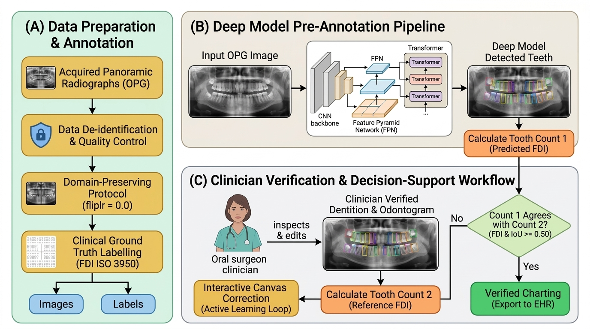
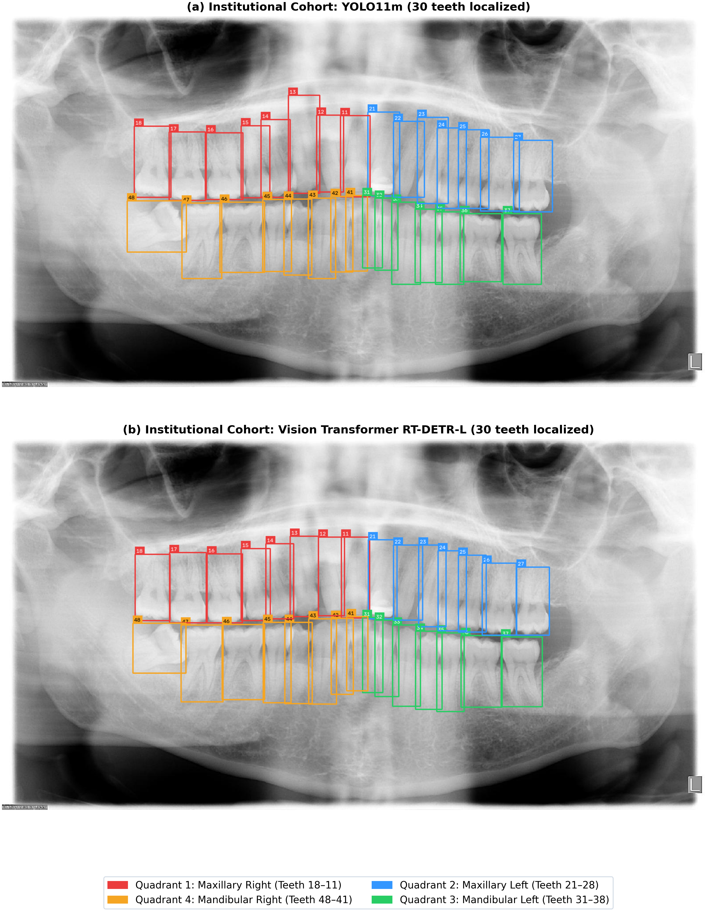
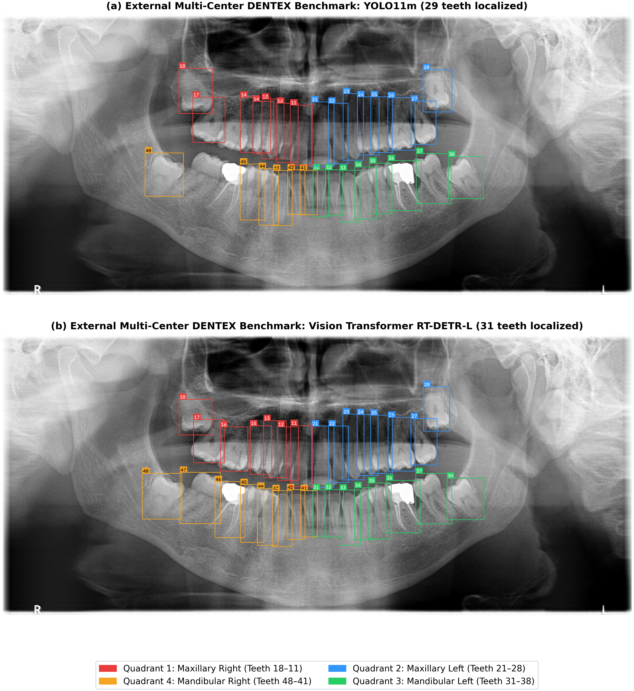
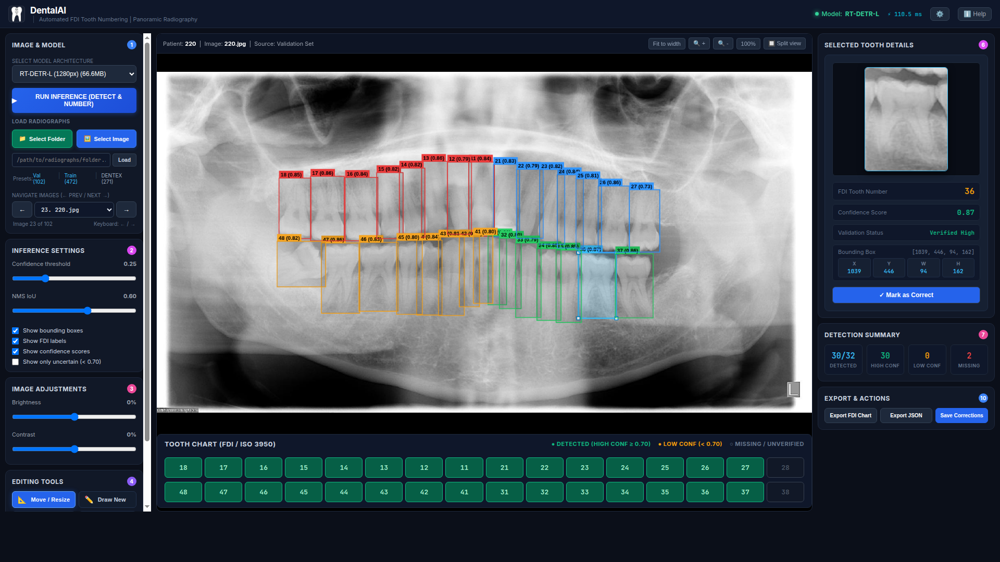

# Automated FDI Tooth Numbering in Panoramic Radiography

[](paper_manuscript.pdf)
[](https://www.python.org/downloads/release/python-31019/)
[](https://pytorch.org/)
[](LICENSE)

Official repository for the study: **"Benchmarking Modern Object Detection Paradigms for Automated FDI Tooth Numbering in Panoramic Radiography: A Multi-Center Generalization Study and Interactive Decision-Support Tool"**.



---

## 📌 Abstract
Accurate tooth identification and numbering on panoramic radiographs (orthopantomograms, OPG) constitute a foundational requirement in clinical dentistry, forensic odontology, and treatment planning. This study presents a comprehensive multi-paradigm benchmark evaluating 15 deep object detectors across:
1. **Modern Anchor-Free Single-Stage Models**: YOLO11 (m, l, x), YOLO12m, YOLOv10m, YOLOv9 (c, e), YOLOv8m, YOLOv3u, YOLO26m.
2. **Real-Time Vision Transformers**: RT-DETR-L, RT-DETR-X, and D-FINE-M.
3. **Classic Multi-Stage Baselines**: Faster R-CNN (ResNet-50-FPN) and Cascade R-CNN.

All models were developed under a standardized high-resolution protocol ($1280 \times 1280$\,px) with strictly enforced anatomical domain preservation ($\text{fliplr} = 0.0$) preventing left/right bilateral quadrant inversion. Out-of-distribution generalizability was evaluated zero-shot on the external multi-center **DENTEX** benchmark ($N=634$ radiographs, 18,095 teeth), paired with a clinical reader study across 50 panoramic radiographs demonstrating an **88.3% reduction** in documentation duration ($240 \pm 35$\,s to $28 \pm 8$\,s, $p < 0.001$).

---

## 🏆 Key Benchmark Results

### Macro Performance Comparison (32 FDI Permanent Teeth, $\text{IoU} \ge 0.50$, $\text{Conf} \ge 0.50$)

| Model Architecture | Input Grid | Internal Precision | Internal Recall | Internal F1 | Internal mAP50 | External DENTEX Prec | External DENTEX Rec | External DENTEX F1 | External DENTEX mAP50 | Latency (RTX 8000) |
| :--- | :---: | :---: | :---: | :---: | :---: | :---: | :---: | :---: | :---: | :---: |
| **YOLO11m** *(Best Internal)* | 1280px | **0.946** | 0.936 | **0.941** | **0.949** | 0.888 | 0.846 | 0.866 | 0.851 | **14.2 ms** |
| **RT-DETR-L** *(Best External)* | 1280px | 0.927 | **0.943** | 0.935 | 0.928 | **0.889** | **0.885** | **0.887** | **0.854** | 22.8 ms |
| **D-FINE-M** *(Best Overall)* | 1280px | 0.934 | 0.947 | **0.940** | 0.941 | 0.875 | 0.880 | 0.878 | **0.878** | 21.4 ms |
| **RT-DETR-X** | 1280px | 0.941 | 0.932 | 0.936 | 0.931 | 0.887 | 0.882 | 0.884 | 0.856 | 35.4 ms |
| **YOLO12m** | 1280px | 0.939 | 0.933 | 0.936 | 0.942 | 0.879 | 0.856 | 0.867 | 0.842 | 16.1 ms |
| **YOLOv9e** | 1280px | 0.950 | 0.937 | 0.944 | 0.948 | 0.874 | 0.849 | 0.861 | 0.835 | 27.4 ms |
| **Cascade R-CNN** *(3-Stage)* | 1280px | 0.908 | 0.925 | 0.916 | 0.884 | 0.851 | 0.853 | 0.852 | 0.772 | 62.4 ms |

---

## 📊 Qualitative Radiographic Comparisons

### Internal Institutional Cohort (Patient 220, 30 present teeth)


### External Cross-Dataset DENTEX Benchmark (Patient 111, 31 present teeth)


---

## 🩺 Interactive Clinical Decision-Support Application

An interactive web-based clinical decision-support and zero-shot pre-annotation interface (`gui_v2/app_v2.py`) was engineered for chairside deployment:



* **Real-time inference switching**: Toggle between YOLO11m, RT-DETR-L, and D-FINE-M.
* **Synchronized FDI Odontogram**: Interactive arch visualizer color-coded by detection confidence.
* **Contextual Per-Tooth RoI Crop Gallery**: $160 \times 200$\,px high-resolution views for inspecting delicate root apices.
* **Interactive Canvas Refinement**: Add, drag, resize, or relabel bounding boxes with active-learning export.

---

## 🚀 Reproduction & Quick Start

### 1. Environment Setup
```bash
git clone https://github.com/venkateshvaddadi/Automated-FDI-Tooth-Numbering-in-Panoramic-Radiography.git
cd Automated-FDI-Tooth-Numbering-in-Panoramic-Radiography

conda create -n dental_fdi python=3.10 -y
conda activate dental_fdi

pip install torch torchvision --index-url https://download.pytorch.org/whl/cu128
pip install ultralytics opencv-python matplotlib scipy scikit-learn
```

### 2. Download Model Checkpoints
All trained model checkpoints (YOLO11m, RT-DETR-L, RT-DETR-X, D-FINE-M, Cascade R-CNN, Faster R-CNN) can be downloaded automatically using the provided script or directly via Google Drive:

* **Automated 1-command download**:
  ```bash
  bash download_model_weights.sh
  ```
* **Direct Google Drive Link**:
  [Google Drive Trained Weights Folder](https://drive.google.com/drive/folders/1QyrHJvjcCHT2chnKBEgRVm-unnwnXXdT?usp=sharing)

All `.pt` and `.pth` checkpoint files will be placed into the local `weights/` directory.

### 3. Launching the Interactive Decision-Support Tool
```bash
python gui_v2/app_v2.py --host 0.0.0.0 --port 7861
```
Open `http://localhost:7861` in your browser.

### 4. Running Benchmark Evaluation & Reproduction
```bash
# Evaluate YOLO11m on the sample test set
python reproduce_benchmark.py --weights weights/yolo11m_teeth_1280.pt --img-dir samples/images --lbl-dir samples/labels

# Run full cross-paradigm evaluation suite
python scripts/evaluate_all_benchmarks.py
```

---

